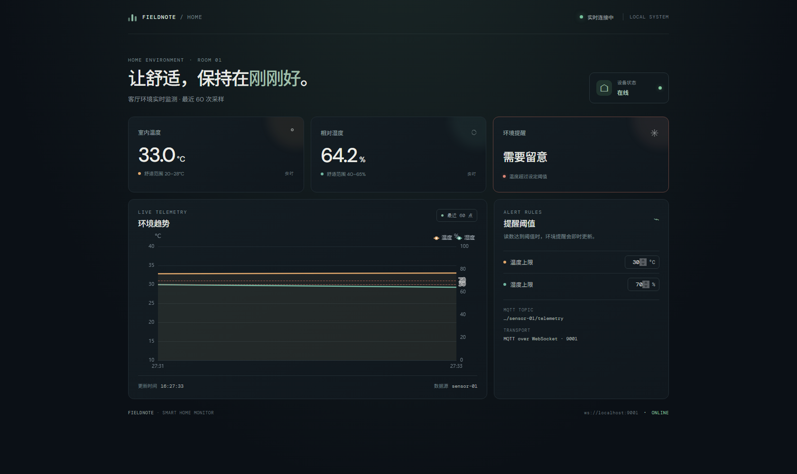
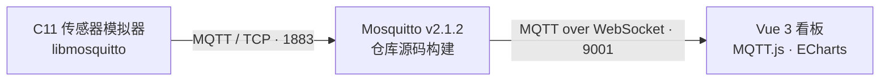

# 智能家居温湿度监控看板

面向家庭室内环境监测场景的 MQTT 端到端示例。C 传感器模拟器定时发布温湿度，Mosquitto Broker 负责转发，Vue 看板通过 WebSocket 实时显示读数、趋势和提醒状态。

**C11 · libmosquitto · Eclipse Mosquitto v2.1.2 · Vue 3 · TypeScript · ECharts · Docker Compose**



## 功能

- 实时展示温度、湿度、设备在线状态和最近 60 次采样趋势。
- 可调整温湿度提醒阈值；读数超限时即时标记环境提醒。
- C11 模拟器用 `libmosquitto` 发布 QoS 1 保留消息，并通过 Last Will 遗嘱消息报告异常离线。
- 提供 `normal` 周期数据和 `alert` 超限演示模式。
- Docker Compose 从仓库内固定版本的 Mosquitto 源码构建 Broker，并启动 C 传感器。

> 当前数据由 C 模拟器生成，未接入实体传感器。

## 架构



## 本机运行

需要 Docker Desktop（含 Docker Compose）和 Node.js 20 或更新版本。

```bash
git clone https://github.com/Doro-6/mqtt-home-dashboard.git
cd mqtt-home-dashboard
docker compose up --build -d
```

第一次启动会从 `third_party/mosquitto/` 编译 Mosquitto Broker，并构建 C 传感器。另开一个终端启动前端：

```bash
cd web
npm ci
npm run dev -- --host 0.0.0.0
```

浏览器打开 <http://localhost:5173>。查看容器状态和日志：

```bash
docker compose ps
docker compose logs -f broker sensor
```

## 演示超限提醒

在项目根目录复制 `.env.example` 为 `.env`，将 `SENSOR_MODE` 改为 `alert`，再重建传感器：

```dotenv
SENSOR_MODE=alert
```

```bash
docker compose up --build -d --force-recreate sensor
```

Windows PowerShell 可用 `Copy-Item .env.example .env` 复制配置文件。恢复周期数据时，将模式改回 `normal` 并再次运行上面的 Compose 命令。

## MQTT 消息

| Topic | 内容 | QoS / 保留 |
| --- | --- | --- |
| `home/livingroom/sensor-01/telemetry` | 温度、湿度、设备 ID、Unix 时间戳 | QoS 1 / 保留 |
| `home/livingroom/sensor-01/status` | `online` / `offline`；异常断开时由 Broker 发布遗嘱 | QoS 1 / 保留 |

遥测示例：

```json
{"deviceId":"sensor-01","timestamp":1794787200,"temperature":24.6,"humidity":51.2}
```

## 上游源码与许可证

[`third_party/mosquitto/`](third_party/mosquitto/) 保存 Eclipse Mosquitto `v2.1.2` 的源码快照，固定 commit 和来源见 [`UPSTREAM.md`](third_party/mosquitto/UPSTREAM.md)。快照不含 `.git` 历史；上游源码文件未修改，许可证、版权声明和 NOTICE 均保留。Docker 构建文件位于 [`docker/mosquitto-broker.Dockerfile`](docker/mosquitto-broker.Dockerfile)。

上游目录采用 EPL-2.0 或 EDL-1.0（BSD-3-Clause）双许可，详见其中的 `LICENSE.txt`、`epl-v20`、`edl-v10` 和 `NOTICE.md`。这只说明上游目录的许可，不自动覆盖本项目新增的应用代码。

## 目录结构

```text
sensor/       C11 温湿度传感器模拟器
mosquitto/    本地 Broker 配置
third_party/  Mosquitto v2.1.2 上游源码快照
docker/       从上游源码构建 Broker 的 Docker 文件
web/          Vue 3 实时看板
.github/      前端、C 代码和 Broker 镜像构建工作流
```

## 停止与安全说明

在项目根目录运行 `docker compose down` 停止并移除容器；数据卷会保留。删除数据卷可运行 `docker compose down -v`。

这是本机演示配置：Broker 只映射到回环地址，并启用了匿名访问。不要把该配置直接暴露到公网；公网部署前需要配置认证、访问控制和 TLS。
